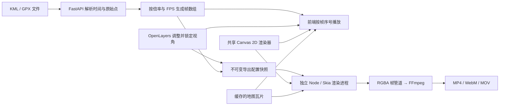

# 前后端与导出设计

## 数据流



后端读取原始经纬度、海拔、时间和轨迹分段，进行必要的数据校验与时间线性插值。KML `gx:Track` 使用逐点 `when/coord`，GPX 使用 `trk/trkseg/trkpt` 或 `rte/rtept` 的经纬度属性、`ele` 和 `time`。两种格式共用归一化与回放逻辑：同一时间整组任意两点的水平距离均不超过 10 米时保留最后一个点，携带分段标记，并在界面提示合并数量；超过限制时拒绝回放。处理只影响内存中的轨迹及导入后的 JSON，不修改上传文件。

对没有逐点时间但带厂商元数据的格式（当前包括 COROS `Track + Laps`），解析器先将分段时长映射到路线锚点，再插值并在轨迹元数据中标记为推导时间。没有评分、几何简化、速度平滑和空间重采样。

前端用 OpenLayers 操作地图中心与可视范围。轨迹、移动标记和可选 HUD 由独立透明 Canvas 绘制。地图模式可叠加实际瓦片，也可完全离线绘制坐标网格；极简模式不绘制底图。

导出不录制浏览器、不依赖实时播放，也不使用页面截图。Node/Skia 加载同一份绘图模块，先按锁定视角生成静态底图 / 路线，再按帧数组绘制前景，并通过背压控制的 RGBA 管道交给 FFmpeg。实际地图瓦片以输出分辨率合成，避免把低分辨率预览截图放大到 4K。

## 固定镜头约束

相机只存储 Mercator 中心 `center: [x, y]` 和水平可视跨度 `span`，禁用旋转。对输出宽高 `W, H`：

```text
resolution = span / W
pixel_x = W/2 + (world_x - center_x) / resolution
pixel_y = H/2 - (world_y - center_y) / resolution
```

标记移动时只改变 `world_x, world_y`，不修改 `center` 或 `span`。窗口缩放时调整 OpenLayers 的显示分辨率，保持世界范围不变。输出宽高比例变化会保留水平跨度，竖直范围随比例变化。

自动 fit 仅由导入、明确点击「显示完整轨迹」或切换坐标系触发，不会由播放进度触发。拖图不使用惯性；锁定、播放和导出会取消仍在进行的 View 动画，并冻结锁定瞬间的视角。前端移动标记不会调用 `view.setCenter()`。

WGS84 到 Mercator 的投影与高德所需的 WGS84 → GCJ-02 转换都在 `shared/scene.mjs` 中完成，因此预览和导出的坐标一致。OpenStreetMap 和离线几何不做 GCJ-02 转换。

## 时间模型

设轨迹开始时刻为 `T₀`、截取范围为 `[a, b]` 秒、倍率为 `s`、输出帧率为 `f`：

```text
Δt = s / f
N = ceil((b - a) * f / s) + 1
source_time(i) = T₀ + min(b, a + i * Δt),  i = 0 ... N-1
video_duration = N / f
```

每帧查找包围该时刻的两个原始点，按时间比例对经度、纬度、海拔和累计距离做线性插值。停留时两个位置相同，插值仍保持不动。最后一帧固定为截取终点；最后一个源时间间隔可能较短，导出时长比理想的 `(b-a)/s` 多 1 到不足 2 帧。这是显式保留首尾帧的约定。

每个原始点格式为：

```text
[longitude, latitude, altitude, utc_seconds, cumulative_meters, segment_start]
```

每个帧格式为：

```text
[longitude, latitude, altitude, cumulative_meters, source_vertex_index, elapsed_seconds, distance_progress]
```

`distance_progress` 是后端按累计里程 / 整条轨迹总里程计算的 0–1 进度，静止点与段间空白不增加进度，零里程轨迹为 0。截取片段保留原路线进度，不按截取时间重置。HUD 直接使用每帧的进度与累计里程，不显示时间或倍率；`elapsed_seconds` 保留用于预览播放条。

前端以 `floor(播放经过秒数 × FPS)` 选取帧，浏览器性能不足时可跳过预览帧以保持节奏。导出会逐帧完整渲染，不跳帧，且与浏览器刷新率无关。

多段之间不线性补点，保持上一段终点直到下一段时间到来。累计距离不计算段间空白。跨日界线先展开经度，防止 179.9° → -179.9° 被插值成横跨地球的路线。

## API

| 方法 / 路径 | 含义 |
| --- | --- |
| `POST /api/tracks` | multipart `file`、可选 `duration_seconds`；解析并保存轨迹 |
| `POST /api/demo` | 导入清理个人元数据后的 West Lake Loop |
| `GET /api/tracks/{id}` | 读取原始点与元数据 |
| `POST /api/tracks/{id}/plan` | `{speed, fps, start, end}` → 等帧间隔的位置数组 |
| `POST /api/exports` | `{trackId, plan, config, camera}` → 202 导出任务 |
| `GET /api/exports/{id}` | 状态、阶段、进度、已渲染帧数、下载地址 |
| `DELETE /api/exports/{id}` | 取消排队或运行中的任务 |
| `GET /api/exports/{id}/download` | 下载已完成文件 |
| `GET /api/tiles/{provider}/{z}/{x}/{y}.png` | 固定地图服务的后端缓存 |
| `GET /api/health` | 检查服务与 FFmpeg 路径 |

导出状态为 `queued → running → done / failed / cancelled`。渲染阶段包括准备、底图加载、逐帧渲染、编码完成。只有 FFmpeg 成功退出且文件存在时才能下载；失败或取消会删除不完整视频。服务重启后保留已完成任务，未完成任务标记为失败。

后端单进程维护串行工作线程，每个任务启动独立 Node 进程，编码最多使用两个线程。任务最多排队三个；输入、状态和输出保存在 `.data/jobs/{uuid}/`。渲染完成后移除临时帧清单，保留视频和状态。轨迹存在 `.data/tracks/`，瓦片存在 `.data/tiles/`。没有自动过期机制，长期使用可在停止服务后清理 `.data/` 或其中的旧任务目录。

在线瓦片只按当前视角请求，后端并发最多四个，浏览器与导出共用本地缓存；导出使用固定服务列表，不能请求任意 URL。地图归属信息绘制在画面中。网络瓦片加载失败会显示错误；导出失败可重试或改为离线网格。

## 渲染的实现边界

`shared/scene.mjs` 的静态底图与全路线仅构造一次。已走路线增量绘制，向后跳转时清除并重建，避免每帧扫描完整原始路线。关闭高亮和 HUD 后，只有移动标记所在的像素会变化。

标记支持圆点、空心环、方向箭头、定位针与准星，预览和导出共用绘制函数。方向箭头按源轨迹段的方向旋转，停留与分段空白时保持方向。已走路线用 `trailColor` 单独着色，保留未走路线的 `routeColor`。

线宽与标记半径在 API 中沿用 640 px 参考画布的等比尺寸，前端数值框显示当前输出画布的实际线宽 / 标记直径。最大线宽 640、最大半径 320，等比换算后均不超过画布短边。所有数值输入框支持点击增减和按住按钮上下拖拽。分辨率、FPS、格式、大小估算与导出按钮置于原生 `dialog` 弹窗；右栏保留入口与任务状态，避免内部滚动条。

Skia 的 `canvas.data()` 返回预乘 RGBA，不能直接传给期望直通 RGBA 的 FFmpeg。导出通过 `getImageData()` 取直通颜色，保持半透明路径颜色。WebM 使用 VP9 alpha，MOV 可选 ProRes 4444 或 HEVC 辅助 Alpha 层；MP4 只接受不透明背景。HEVC Alpha 使用独立、经过真实 RGBA 往返验证的编码器；API 格式为 `hevc-alpha`，任务的 `encoding` 保留此值，文件扩展名和下载 MIME 按 MOV 处理。

预览与导出共用绘图函数、投影、相机与样式参数；浏览器和 Skia 的字体栅格化 / 抗锯齿实现仍可能有细微差异。真实地图的预览瓦片层由 OpenLayers 合成，导出按同一投影和范围重新合成；不承诺位级一致。
